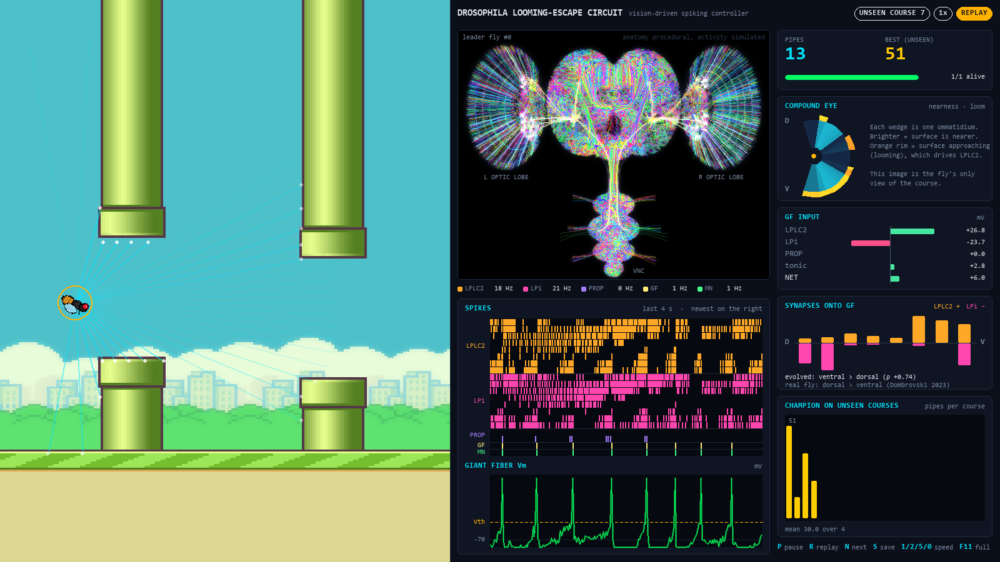
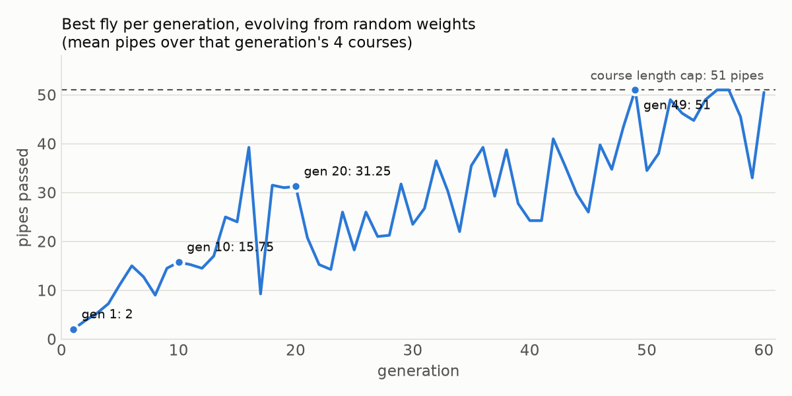

# 🪰 A fruit fly's escape circuit learns Flappy Bird

A spiking model of the *Drosophila* looming-escape pathway (compound eye → LPLC2 / LPi → Giant Fiber) flies a Flappy Bird course using **only what its compound eye sees**. Evolution tunes the synapses. The controller is never told where the gap is, how far the next pipe is, or how high it's flying.



> **Result:** on 50 courses it never trained on, the evolved circuit passes **29.5 pipes on average** (median 32; 19 of the 50 courses flown all the way to the 51-pipe cap).
> Evolution also gave the LPLC2 → Giant Fiber synapses a **ventral > dorsal** gradient, the *reverse* of the real fly. See [the finding](#the-finding-evolution-reverses-the-flys-synaptic-gradient).

## How it works

```text
            ┌──────────────────────────────────────────────┐
  world ──► │ COMPOUND EYE  33 ommatidia, +100° … −100°      │  nearness of the first surface on each
            │ (acute zone: 2.5° at the horizon, 13° at edges)│  line of sight, nothing else
            └───────────────┬──────────────────────────────┘
                            │ temporal contrast: loom = d(nearness)/dt ≥ 0      (T4/T5-like, graded)
              ┌─────────────┴──────────────┐
              ▼                            ▼
   ┌────────────────────┐      ┌────────────────────┐      ┌──────────────────┐
   │ LPLC2 ×8  (ACh, +)  │      │ LPi ×8  (Glu, −)    │      │ PROP ×2          │ climbing / sinking
   │ retinotopic LIF     │      │ retinotopic LIF     │      │ body-velocity    │ (the fly's own state)
   └─────────┬──────────┘      └─────────┬──────────┘      └────────┬─────────┘
             └──────────────► GIANT FIBER (LIF) ◄───────────────────┘
                                   │ spike
                                   ▼
                        flight motor neurons → wing stroke
```

Every neuron is a leaky integrate-and-fire unit, integrated at 4 substeps per frame (≈4 ms). A Giant Fiber spike commands a wing stroke. The 25 evolved genes are each unit's sensitivity to nearness and to looming, every synapse onto the GF, and the GF's tonic drive, membrane time constant and threshold.

There are **no hand-coded reflexes**. Earlier versions had a "ceiling lockdown" and a "ground emergency" current. Both are gone: the ceiling and ground are surfaces the eye can see, like the pipes.

### What is biology and what isn't

| Borrowed from the real fly | Simplified or invented |
|---|---|
| LPLC2 as looming detectors driving the GF (Klapoetke 2017, Ache 2019) | The 2-D world gives a 1-D eye (elevation only) that measures *nearness* per ommatidium |
| Sign of every synapse (Dale's law): LPLC2 cholinergic +, LPi glutamatergic − (Mauss 2015) | Real LPi inhibit LPLC2 dendrites; here they synapse onto the GF directly |
| Retinotopic receptive fields tiling the eye dorsal → ventral | 8 units per type instead of ~100 LPLC2 per side |
| The GF as the single command neuron for the escape (von Reyn 2014) | PROP is a generic body-velocity sense (real halteres sense rotation) |
| A non-uniform eye with an acute zone | Synaptic weights are **evolved, not read from the FlyWire connectome** |

The brain render in the dashboard is procedural art in the style of FlyWire, **not** FlyWire meshes. The activity on it is real, though: every flash is a spike of the leader fly's simulated circuit, and medulla columns glow with their ommatidium's input.

## The finding: evolution reverses the fly's synaptic gradient

In real flies, LPLC2 neurons watching the **dorsal** visual field drive the Giant Fiber harder than ventral ones (Dombrovski et al. 2023, *Nature* 613:534). A looming threat from above, like a swatter or a bird, is the one to escape by jumping.

Flappy Bird inverts that logic. A wing stroke moves you *up*, so the obstacle to escape is the one **below**. Starting from random weights with the sign constraints above, evolution consistently builds the opposite gradient:

```
                       dorsal ─────────────────────────────► ventral
evolved LPLC2 → GF:     7.3   8.4  14.2  10.4   8.3  40.0  33.8  28.8   (Spearman ρ = +0.74)
evolved LPi   → GF:   −29.8 −40.0  −3.2  −2.6  −0.3  −3.9  −0.4 −32.6
real fly LPLC2 → GF:  stronger ─────────────────────────────► weaker
```

Ventral LPLC2 synapses end up nearly 3× stronger than dorsal ones, and the strongest LPi inhibition sits dorsally (don't flap into the pipe above). The same wiring rules, tuned by a different environment, produce a mirror-image circuit. All four training runs during development, including two with earlier eye designs, came out ventral > dorsal (ρ between +0.67 and +0.83). `python train.py` prints this comparison after every run.

## Watching it learn

`python main.py --fresh` starts a swarm of 96 flies with random synapses and evolves them live. This is the same run, headless:



| generation | best fly (mean pipes over 4 courses) | population mean fitness |
|---|---|---|
| 1 | 2.0 | 242 |
| 10 | 15.8 | 1,020 |
| 20 | 31.3 | 2,014 |
| 49 | 51.0 (every course flown to the cap) | 2,596 |
| 60 | 50.5 | 5,150 |

Raw numbers: [`docs/learning_curve.csv`](docs/learning_curve.csv). The curve is jagged because each generation flies 4 *new* courses, so a fly that aced last generation's courses can stumble on this one's.

### Questions people ask when they watch it

**Why do most flies crash in the first few pipes, even late in a run?**
Only the 4 elites are copies of last generation's best. The other 92 are mutated or crossed-over experiments, and most experiments are worse. That's the price of searching. The leader the dashboard follows is always the best-ranked survivor, and the population *mean* climbs steadily (242 → 5,150).

**Why does the score stop at 51 pipes?**
Every course is capped at 6,000 frames (100 s at 60 fps), about 51 pipes. Without a cap a perfect fly would run forever and a generation would never end. A fly that reaches it gets the maximum fitness of 16,960.

**Is the fly really in control?**
Yes. Each frame the only inputs are the 33 ommatidium readings and the fly's own vertical velocity. The world never tells the circuit where the gap is. The one line that moves the fly is `world.step(circuit.step(nearness, vy))` in `main.py`: a wing stroke happens if and only if the Giant Fiber spiked.

## Lessons from building it

**1. Harmonic multi-course fitness stops "specialists".**
A genome that memorises one course scores very high there and crashes everywhere else. Selection uses the harmonic mean of distance over 4 courses, which drops a genome that scores `8,000` on one course and `30` on another to `~60`. The courses also change **every generation**. The final champion is picked from the record holders by re-scoring them on separate validation courses, and the results above come from a third set of test courses that neither selection nor that pick ever saw.

**2. Before blaming the learner, find out what the sensor can support.**
The first vision-driven version plateaued around 5 pipes, so I trained a plain *linear* readout of the same eye as an upper bound, and it stalled too. The cause was resolution: a stroke lifts the fly ~49 px and the gap leaves little room, so the fly needs about 2° of precision at range, while the ommatidia were 6° apart. Adding an **acute zone** (denser ommatidia at the horizon, as real fly eyes have) took the linear readout to 48.5/51 pipes on unseen courses, and the spiking circuit trained well after that.

**3. Shaping selection is fine; shaping the input is not.**
Early generations all die at the first pipe, so selection adds a small bonus for dying close to the gap. That uses the game's ground truth, but only to *rank* genomes. The fly never sees it.

## Run it

```bash
git clone https://github.com/onithaperera/fly-flappy-bird.git
cd fly-flappy-bird
pip install -r requirements.txt

python main.py --replay        # watch the shipped champion fly courses it has never seen
python main.py                 # watch a swarm evolve live (seeded with the champion if present)
python main.py --fresh         # watch evolution from scratch: random weights, no saved champion
python train.py                # evolve headlessly (much faster), then score on held-out courses
python train.py --eval champion_genome.npz --test-courses 100
python experiments/linear_probe.py   # the linear upper-bound check from "Lessons" above
```

Python 3.10+. Tests: `pip install -r requirements-dev.txt && pytest`.

The shipped `champion_genome.npz` came from 120 generations (about an hour on a laptop CPU):

```bash
python train.py --generations 60
python train.py --generations 60 --seed 1 --resume champion_genome.npz
```

### Controls

| Key | |
|---|---|
| `P` | pause |
| `R` | toggle replay of the champion on unseen courses |
| `N` / `Space` | next unseen course (replay) |
| `S` | save the champion to `champion_genome.npz` (overwrites the shipped one) |
| `1` `2` `5` `0` | speed 1×, 2×, 5×, 15× |
| `F11` / `Esc` | fullscreen / quit |

### The dashboard

* **Arena:** the swarm, with the leader's lines of sight. Each ray stops at the first surface it meets.
* **Brain:** the leader's live circuit on a procedural fly brain.
* **Spikes:** raster of every LPLC2, LPi and PROP unit, the GF and the motor output, above the GF membrane potential on the same time axis.
* **Compound eye:** the 33 ommatidia as a fan. Brightness is nearness, and the orange rim is looming.
* **GF input:** synaptic current into the GF by pathway.
* **Synapses onto GF:** the leader's evolved LPLC2 (+) and LPi (−) weights from dorsal to ventral, next to the biological gradient.

## Project layout

```text
world.py          headless, vectorised physics for the whole swarm
retina.py         the compound eye (ray-cast nearness panorama, acute zone)
circuit.py        the spiking circuit and the genome layout
evolution.py      GA, harmonic multi-course fitness, checkpoints
connectome.py     sources for the biology and the evolved-vs-real gradient comparison
train.py          headless training and held-out evaluation
main.py           live pygame app
game.py           arena drawing
dashboard.py      telemetry panels
brain_visualizer.py  procedural brain + live activity
experiments/      linear_probe.py: can a linear readout of the eye fly?
tests/            pytest suite
```

## References

* Klapoetke N. C. et al. (2017). Ultra-selective looming detection from radial motion opponency. *Nature* 551, 237–241.
* Ache J. M. et al. (2019). Neural basis for looming size and velocity encoding in the *Drosophila* Giant Fiber escape pathway. *Current Biology* 29, 1073–1081.
* Mauss A. S. et al. (2015). Neural circuit to integrate opposing motions in the visual field. *Cell* 162, 351–362.
* von Reyn C. R. et al. (2014). A spike-timing mechanism for action selection. *Nature Neuroscience* 17, 962–970.
* Dombrovski M. et al. (2023). Synaptic gradients transform object location to action. *Nature* 613, 534–542.

Background, pipe and ground sprites come from [samuelcust/flappy-bird-assets](https://github.com/samuelcust/flappy-bird-assets).
